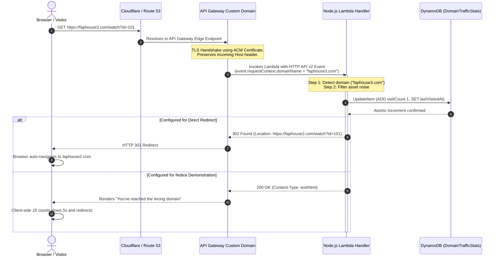

# Architecture Design: Multi-Domain Traffic Gateway

This document explains how a single serverless backend can receive, track, and route traffic across multiple domains (`faphouse.com`, `faphouse2.com`, `faphouse3.com`) with zero dedicated server maintenance and near-zero cost.

---

## 1. High-Level Architecture Overview

```mermaid
flowchart TD
    subgraph Clients["User Ingress"]
        C1["User visits faphouse.com"]
        C2["User visits faphouse2.com"]
        C3["User visits faphouse3.com (New)"]
    end

    subgraph EdgeDNS["DNS & Edge Routing"]
        CF["Cloudflare / Route 53 DNS<br>(CNAME or A-Alias Records)"]
        ACM["AWS Certificate Manager (ACM)<br>(Multi-domain SSL/TLS Certificate)"]
    end

    subgraph AWSBackend["AWS Serverless Backend"]
        APIGW["Amazon API Gateway (HTTP API v2)<br>3 Custom Domain Names Mapped to 1 Stage"]
        LAMBDA["AWS Lambda (Node.js 20.x/22.x)<br>Domain Tracker & Routing Controller"]
        DDB[("Amazon DynamoDB<br>DomainTrafficStats Table")]
    end

    subgraph Destinations["Traffic Destinations"]
        RDIR["HTTP 302 Redirect to faphouse2.com"]
        HTML["Wrong-Domain HTML Notice Page"]
        PASS["Target Operational Application"]
    end

    C1 --> CF
    C2 --> CF
    C3 --> CF
    CF --> APIGW
    ACM -.-> APIGW
    APIGW --> LAMBDA
    LAMBDA <--> DDB
    LAMBDA -->|If faphouse3.com (Instant)| RDIR
    LAMBDA -->|If faphouse3.com (Notice)| HTML
    LAMBDA -->|If faphouse2.com| PASS
```

---

## 2. Request Flow Lifecycle

The sequence below illustrates the step-by-step lifecycle of a request made to `faphouse3.com`:



---

## 3. How a Single Backend Handles Multiple Domains

### The Problem
Traditional hosting often provisions separate web servers (Nginx/Apache virtual hosts) or distinct microservices for every individual domain name. This results in multiplied operational overhead, separate SSL certificates, and fractured metrics.

### The Solution: Multi-Domain API Gateway Mapping
Amazon API Gateway supports **Custom Domain Names**. You can create multiple custom domain names pointing to the exact same API Gateway stage:

1. **Custom Domain 1**: `faphouse.com` -> mapped to `HTTP API (id: gw3domains) / $default`
2. **Custom Domain 2**: `faphouse2.com` -> mapped to `HTTP API (id: gw3domains) / $default`
3. **Custom Domain 3**: `faphouse3.com` -> mapped to `HTTP API (id: gw3domains) / $default`

### How Lambda Knows Which Domain Was Called
When a request passes through API Gateway, API Gateway creates a JSON payload for Lambda:
- **`event.requestContext.domainName`**: Contains the exact custom domain name matching the incoming request (e.g. `faphouse3.com`).
- **`event.headers['host']`**: Contains the client's HTTP Host header.
- **`event.rawPath`** and **`event.rawQueryString`**: Retains the complete URI path and query arguments for lossless forwarding.

---

## 4. Component Deep Dive

### A. AWS API Gateway (HTTP API v2)
- **Why HTTP API instead of REST API?**
  - ~70% lower cost ($1.00 per million requests vs $3.50 for REST API).
  - Faster latency (simpler internal architecture, no unnecessary XML/mapping transforms).
  - Native v2 event format with clean routing keys.
  - Automatic TLS termination.

### B. AWS Lambda (Node.js 20.x or 22.x)
- Runs completely on-demand (scales from 0 to thousands of concurrent requests).
- Cold start in Node.js is minimal (~150-250ms), and warm invocations execute in **under 15ms**.
- Acts as the central router and metrics collector.

### C. Amazon DynamoDB
- Serverless NoSQL database with single-digit millisecond read/write latency.
- Incur zero hourly charges when set to **On-Demand Capacity** mode.
- Supports **Atomic Counters** (`ADD visitCount :val`), guaranteeing exact visit numbers even under heavy concurrent traffic without read-modify-write race conditions.

---

## 5. Cost Analysis (AWS Free Tier & Scaling)

| Service | Free Tier Allowance | Ongoing Pay-As-You-Go Cost |
|---|---|---|
| **API Gateway HTTP API** | 1,000,000 calls / month free (first 12 months) | $1.00 per 1M requests |
| **AWS Lambda** | 1,000,000 requests & 3.2M seconds compute free forever | $0.20 per 1M requests |
| **Amazon DynamoDB** | 25 GB storage + 25 WCU / 25 RCU free forever | ~$0.00 (within free tier) |
| **AWS Certificate Manager (ACM)**| Unlimited public SSL certificates | **Free** |
| **Total Estimated Cost** | **$0.00 / month** for the first 1M requests | ~$1.20 / million requests thereafter |
