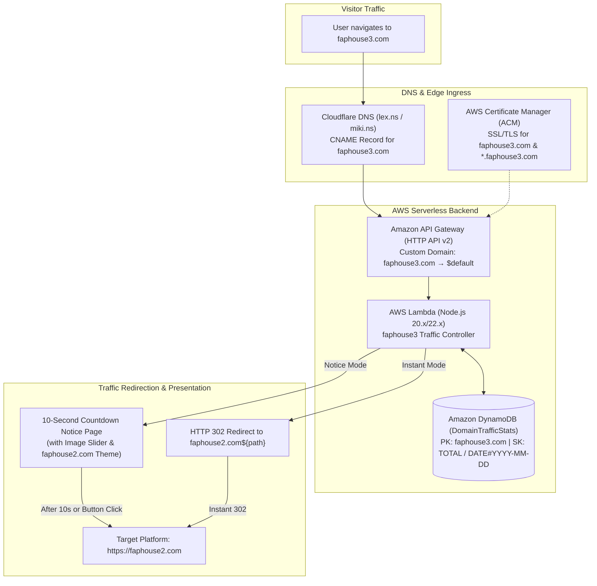
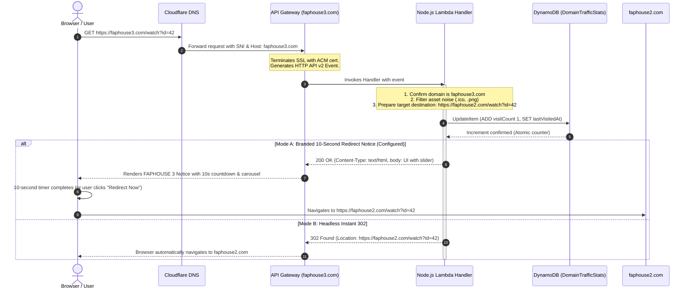

# Architecture Design: Single Domain Traffic Gateway (`faphouse3.com` &rarr; `faphouse2.com`)

This document details the serverless architecture designed specifically for **`faphouse3.com`** as a single dedicated ingress gateway that counts visitors, displays a branded 10-second redirect notice with an image slider, and forwards traffic to **`faphouse2.com`**.

---

## 1. Single-Domain Architecture Diagram

---

## 2. Request Flow Lifecycle for `faphouse3.com`

---

## 3. Why a Single Domain Gateway Architecture?

Operating `faphouse3.com` as a dedicated edge redirector provides three core advantages:

1. **Anti-Censorship & Link Protection**: When regional ISPs block `faphouse.com`, new links and marketing campaigns point to `faphouse3.com`. The gateway captures this traffic and safely routes users to `faphouse2.com`.
2. **Visitor Intelligence**: Every request hitting `faphouse3.com` is logged in DynamoDB before forwarding, providing exact metrics on how many users are arriving via this new domain.
3. **Zero Maintenance & Minimal Cost**:
   - Zero dedicated servers.
   - API Gateway HTTP API charges $1.00 per 1M requests.
   - DynamoDB On-Demand capacity is free within AWS Free Tier (25 WCU / 25 RCU).
   - ACM SSL certificates are 100% free.

---

## 4. Key Serverless Components

### A. Amazon API Gateway (HTTP API v2)
- Handles SSL/TLS termination for `faphouse3.com`.
- Preserves full incoming path (`event.rawPath`) and query parameters (`event.rawQueryString`).
- Integrates directly with your Lambda function via the `$default` route.

### B. AWS Lambda (Node.js 20.x or 22.x)
- Executes in under 15ms.
- Reads `TARGET_DOMAIN=https://faphouse2.com` and `COUNTDOWN_SECONDS=10` from environment variables.
- Updates visit counts in DynamoDB atomically.

### C. Amazon DynamoDB (`DomainTrafficStats`)
- Single table partitioned by `domain = "faphouse3.com"`.
- Tracks all-time visits (`metric: "TOTAL"`) and daily rollups (`metric: "DATE#YYYY-MM-DD"`).
